# UML hiện tại — bản đang thảo luận

Tổng hợp các phần đã trao đổi, chưa phải UML v1 hoàn chỉnh. Các thuộc tính/phương thức trong bản phác User và tài khoản vẫn đang được rà soát. Transaction dùng một lớp và enum, đã bổ sung các trường được chọn, không lưu người thực hiện.

## Các khối User, Account, Transaction, Service, Repository và Factory trên cùng sơ đồ

Nguồn Mermaid mới nhất: [class-diagram-current.mmd](class-diagram-current.mmd) và sơ đồ Mermaid bên dưới. Các ảnh [PNG](class-diagram.png) / [SVG](class-diagram.svg) được xuất trước khi bổ sung Singleton/Factory nên **cần xuất lại** để khớp nguồn mới.

```mermaid
classDiagram
    direction TB

    namespace USER {

    class User {
        <<abstract>>
        -String userId
        -String username
        -String passwordHash
        -UserStatus status
        -boolean mustChangePassword
        +changePassword(currentPassword, newPassword)
        +resetPassword(temporaryPassword)
        +deactivate()
        +getRole() UserRole*
    }

    class Customer {
        -String customerId
        -String fullName
        -String phone
        -String email
        -String address
        -List~BankAccount~ accounts
        +updateContactInfo(phone, email, address)
        +changeName(fullName)
        +getRole() UserRole
    }

    class Employee {
        +getRole() UserRole
    }

    class UserStatus {
        <<enumeration>>
        ACTIVE
        INACTIVE
    }

    class UserRole {
        <<enumeration>>
        EMPLOYEE
        CUSTOMER
    }

    }

    namespace ACCOUNT {

    class BankAccount {
        <<abstract>>
        -String accountNumber
        -String customerId
        -BigDecimal balance
        -AccountStatus status
        +getBalance() BigDecimal
        +getAccountType() AccountType*
    }

    class CheckingAccount {
        +deposit(amount)
        +withdraw(amount)
        +close()
        +reopen()
        +getAccountType() AccountType
    }

    class SavingsAccount {
        -int termMonths
        -BigDecimal annualRate
        -BigDecimal earlyWithdrawalRate
        -LocalDate startDate
        -LocalDate endDate
        +calculateInterest(onDate) BigDecimal
        +getAccountType() AccountType
    }

    class LoanAccount {
        -BigDecimal annualRate
        -LocalDate startDate
        -LocalDate endDate
        +calculateInterest() BigDecimal
        +calculateTotalDue() BigDecimal
        +getAccountType() AccountType
    }

    class AccountStatus {
        <<enumeration>>
        ACTIVE
        INACTIVE
    }

    class AccountType {
        <<enumeration>>
        CHECKING
        SAVINGS
        LOAN
    }

    }

    namespace TRANSACTION {

    class Transaction {
        -String transactionId
        -BigDecimal amount
        -String fromAccountNumber
        -String toAccountNumber
        -TransactionType type
        -LocalDateTime occurredAt
        -String note
    }

    class TransactionType {
        <<enumeration>>
        DEPOSIT
        WITHDRAWAL
        TRANSFER
        SAVINGS_OPEN
        SAVINGS_SETTLEMENT
        LOAN_DISBURSEMENT
        LOAN_REPAYMENT
    }

    }

    namespace SERVICE {

    class AccountService {
        <<interface>>
        +openCheckingAccount(customerId) CheckingAccount
        +findByAccountNumber(accountNumber) BankAccount
        +findByCustomerId(customerId) List~BankAccount~
        +closeCheckingAccount(accountNumber)
        +reopenCheckingAccount(accountNumber)
    }

    class AccountServiceImpl

    class TransactionService {
        <<interface>>
        +deposit(accountNumber, amount) Transaction
        +withdraw(accountNumber, amount) Transaction
        +transfer(fromAccountNumber, toAccountNumber, amount) Transaction
    }

    class TransactionServiceImpl

    class SavingsService {
        <<interface>>
        +openSavingsAccount(customerId, amount, termMonths) SavingsAccount
        +settleSavingsAccount(accountNumber) void
        +settleMaturedSavings() void
    }

    class SavingsServiceImpl

    class LoanService {
        <<interface>>
        +openLoanAccount(customerId, amount, annualRate, endDate) LoanAccount
        +repayLoanAccount(accountNumber) void
    }

    class LoanServiceImpl

    class ReportService {
        <<interface>>
        +generateAccountReport() String
        +generateTransactionReport(fromDate, toDate) String
        +generateTodayTransactionReport() String
    }

    class ReportServiceImpl

    }

    namespace REPOSITORY {

    class JsonRepository {
        <<Singleton>>
        -JsonRepository INSTANCE$
        -JsonRepository()
        +getInstance() JsonRepository$
        +load()
        +save()
    }

    }

    namespace FACTORY {

    class AccountServiceFactory {
        -AccountServiceFactory()
        +create(...) AccountService$
    }

    class TransactionServiceFactory {
        -TransactionServiceFactory()
        +create(...) TransactionService$
    }

    class SavingsServiceFactory {
        -SavingsServiceFactory()
        +create(...) SavingsService$
    }

    class LoanServiceFactory {
        -LoanServiceFactory()
        +create(...) LoanService$
    }

    class ReportServiceFactory {
        -ReportServiceFactory()
        +create(...) ReportService$
    }

    }

    AccountServiceImpl ..|> AccountService
    TransactionServiceImpl ..|> TransactionService
    SavingsServiceImpl ..|> SavingsService
    LoanServiceImpl ..|> LoanService
    ReportServiceImpl ..|> ReportService
    AccountServiceFactory ..> AccountServiceImpl : tao mac dinh
    TransactionServiceFactory ..> TransactionServiceImpl : tao mac dinh
    SavingsServiceFactory ..> SavingsServiceImpl : tao mac dinh
    LoanServiceFactory ..> LoanServiceImpl : tao mac dinh
    ReportServiceFactory ..> ReportServiceImpl : tao mac dinh
    AccountServiceFactory ..> JsonRepository : nhan dependency
    TransactionServiceFactory ..> JsonRepository : nhan dependency
    SavingsServiceFactory ..> JsonRepository : nhan dependency
    LoanServiceFactory ..> JsonRepository : nhan dependency
    ReportServiceFactory ..> JsonRepository : nhan dependency
    AccountService ..> BankAccount : tra cứu
    TransactionService ..> CheckingAccount : nộp/rút/chuyển
    TransactionService ..> Transaction : ghi giao dịch
    SavingsService ..> SavingsAccount : quản lý
    LoanService ..> LoanAccount : quản lý
    ReportService ..> BankAccount : thống kê tài khoản
    ReportService ..> Transaction : thống kê giao dịch
    note for ReportService "generateTodayTransactionReport() la default method"

    User <|-- Customer
    User <|-- Employee
    User --> UserStatus : status
    User ..> UserRole : getRole()
    BankAccount <|-- CheckingAccount
    BankAccount <|-- SavingsAccount
    BankAccount <|-- LoanAccount
    BankAccount --> AccountStatus : status
    BankAccount ..> AccountType : getAccountType()
    Customer "1" *-- "0..*" BankAccount : accounts
    Transaction "0..*" --> "0..1" BankAccount : fromAccountNumber
    Transaction "0..*" --> "0..1" BankAccount : toAccountNumber
    Transaction --> TransactionType : type
    note for Transaction "Tất toán: amount = gốc + lãi"
    note for LoanAccount "Tối đa 1 ACTIVE/khách; không đóng tài khoản thanh toán khi còn nợ"
```

Hai khung USER và ACCOUNT được giữ trên cùng sơ đồ, bổ sung khung TRANSACTION. **Đã chốt Composition `Customer "1" *-- "0..*" BankAccount` (hình thoi đặc phía Customer)**: Customer sở hữu `List<BankAccount> accounts`, mỗi tài khoản thuộc đúng một Customer trong suốt vòng đời. Một Customer có tối đa một CheckingAccount, nhiều SavingsAccount và lịch sử LoanAccount. `BankAccount.customerId` vẫn là mã chủ sở hữu để kiểm tra nhất quán, **không vẽ thành quan hệ thứ hai**. Ngừng hoạt động (`INACTIVE`) không phải xóa Customer: hồ sơ, tài khoản INACTIVE và lịch sử vẫn được giữ.

Khối SERVICE đã chốt cách tách **AccountService, TransactionService, SavingsService, LoanService và ReportService**, mỗi interface có lớp Impl tương ứng. `ReportServiceImpl` triển khai `ReportService` cho đúng hai báo cáo đã chốt với `generateAccountReport(): String` và `generateTransactionReport(LocalDate fromDate, LocalDate toDate): String`; **đã chốt thêm `default generateTodayTransactionReport(): String` gọi `generateTransactionReport(LocalDate.now(), LocalDate.now())`**, chỉ là lối tắt cho báo cáo hôm nay, không phải báo cáo thứ ba; service tạo nội dung, menu console hiển thị, không tạo lớp kết quả riêng. `TransactionService` phụ trách nộp/rút/chuyển tiền thông thường, cập nhật CheckingAccount và ghi Transaction; **đã chốt 3 phương thức `deposit`, `withdraw`, `transfer`, cùng trả về `Transaction`**. Đã chốt 3 phương thức SavingsService và 2 phương thức LoanService, trả về trực tiếp thực thể khi mở sổ/vay và `void` khi tất toán/thu nợ. Không thêm lớp kết quả hay hàm service tính lãi trùng model. `AccountService` đã chốt đủ 5 phương thức mở, tra cứu, đóng và kích hoạt lại tài khoản cũ như trên UML (hai hàm đóng/mở lại còn hoàn thiện kiểu trả về khi viết Java). Chưa có mã nguồn service. Xem quyết định chi tiết tại `docs/THIET-KE-UML.md`.

Service điều phối quyền, tìm đối tượng, cập nhật các tài khoản liên quan và ghi giao dịch theo phạm vi của mình. Tiết kiệm/khoản vay không dùng closeCheckingAccount để kết thúc. Phần nộp/rút/chuyển khoản đã giao cho TransactionService; đã chốt lưu một file `data/bank-data.json`: dữ liệu Customer chứa các tài khoản **một lần ở `Customer.accounts`**, không thêm danh sách accounts độc lập ở cấp gốc; lịch sử Transaction nằm trong danh sách chung riêng biệt. Tra cứu tài khoản qua Customer, đối chiếu customerId với chủ sở hữu; không sao chép thêm một bộ tài khoản. Đã chốt tự lưu ngay sau mỗi nghiệp vụ thành công thay đổi dữ liệu, không chỉ lúc thoát; thao tác chỉ tra cứu không ghi. Đã bổ sung `JsonRepository` dạng Singleton và năm Simple Factory trên UML. Mỗi Factory cung cấp phương thức static `create(...)` trả về interface service, ban đầu tạo đúng một loại implementation mặc định. Factory nhận dependency khi khởi tạo, không lưu registry, không tạo DI container hay tự biến service thành Singleton. Dấu `...` trên UML biểu thị danh sách tham số injection **chưa chốt** (tùy nhu cầu từng service). Schema/đọc ghi JSON, cách xử lý lỗi lưu và phụ thuộc cụ thể vẫn cần hoàn thiện.

Transaction lưu nguồn/đích bằng số tài khoản. Nộp tiền mặt không có tài khoản nguồn; rút tiền mặt không có tài khoản đích. Chuyển khoản, mở sổ và tất toán có cả nguồn lẫn đích. Giải ngân ghi nguồn là khoản vay, đích là tài khoản thanh toán; trả nợ ghi chiều ngược lại. Đây là mô tả giao dịch, không có nghĩa áp dụng cùng một phép trừ/cộng balance cho mọi loại tài khoản. Không có liên kết Transaction tới User vì đã chọn bỏ người thực hiện.

## Cách đọc và ràng buộc

- Mũi tên tam giác rỗng biểu diễn kế thừa.
- Composition (hình thoi đặc): `Customer` sở hữu danh sách `accounts` gồm các `BankAccount` thực. `BankAccount.customerId` chỉ xác nhận mã chủ sở hữu, không lưu ngược đối tượng Customer; một tài khoản không được nằm trong danh sách của hai Customer. Đóng tài khoản hoặc chuyển Customer sang INACTIVE không được xóa các đối tượng và lịch sử đã lưu.
- Một Customer có tối đa một CheckingAccount và nhiều SavingsAccount. Tài khoản thanh toán đã đóng được mở lại với số cũ.
- Một User.status chung (ACTIVE/INACTIVE) quyết định hoạt động/đăng nhập. Customer không lưu trạng thái riêng.
- AccountStatus đã chốt ACTIVE/INACTIVE cho tài khoản ngân hàng. Đóng tài khoản hoặc tất toán sổ chuyển sang INACTIVE; mở lại tài khoản thanh toán chuyển về ACTIVE. User.status là trạng thái người dùng độc lập.
- UserRole: EMPLOYEE/CUSTOMER. AccountType: CHECKING/SAVINGS/LOAN.
- LoanAccount đã chốt lưu dư nợ gốc bằng balance dương, nhân viên giải ngân vào tài khoản thanh toán, khách đăng nhập tự trả toàn bộ gốc+lãi của khoản vay mình từ tài khoản thanh toán. Trả thành công: balance về 0, status tự thành INACTIVE, không có thao tác đóng riêng. Mỗi khách chỉ có một LoanAccount ACTIVE tại một thời điểm; khi khoản cũ INACTIVE thì được tạo khoản vay mới và giữ khoản cũ trong lịch sử. Một Customer có thể có nhiều LoanAccount trong toàn bộ lịch sử; giới hạn một khoản ACTIVE được kiểm tra khi mở khoản vay. Trong báo cáo tài khoản, tách số khoản vay ACTIVE/INACTIVE và tổng dư nợ gốc khỏi số dư tiền gửi; báo cáo giao dịch tách LOAN_DISBURSEMENT và LOAN_REPAYMENT thành hai nhóm riêng, không tạo báo cáo thứ ba.
- LoanAccount lưu annualRate = 0,10 (lãi cố định 10%/năm), startDate (ngày giải ngân) và endDate (ngày kết thúc kỳ hạn 6/12 tháng). Không thêm termMonths: xác định kỳ hạn bằng cách so endDate với startDate.plusMonths(6/12). calculateInterest() = dư nợ gốc × annualRate × kỳ hạn tháng / 12, làm tròn đồng HALF_UP; calculateTotalDue() = gốc + lãi. Không phụ thuộc ngày trả thực tế, không có lãi quá hạn/phí phạt. Lịch sử gốc tra từ giao dịch giải ngân.
- Các enum được vẽ thành ô riêng với ký hiệu enumeration. UserRole và AccountType là kiểu trả về của phương thức, không phải thuộc tính lưu thêm trong lớp cha.
- TransactionType: DEPOSIT/WITHDRAWAL/TRANSFER/SAVINGS_OPEN/SAVINGS_SETTLEMENT/LOAN_DISBURSEMENT/LOAN_REPAYMENT. occurredAt lưu ngày và giờ; note ghi nội dung và mã giao dịch sai khi điều chỉnh bằng giao dịch thông thường.
- LOAN_DISBURSEMENT ghi amount bằng số tiền gốc được giải ngân. LOAN_REPAYMENT ghi amount bằng tổng gốc+lãi thực thu, note ghi chi tiết. Service phối hợp tài khoản: giải ngân tạo dư nợ và cộng tiền thanh toán; trả nợ trừ tổng tiền thanh toán và xóa dư nợ gốc. Không rút trực tiếp tiền từ LoanAccount hoặc cộng tiền trả nợ vào dư nợ.
- amount khi tất toán đã chốt là tổng gốc + lãi thực trả về tài khoản thanh toán. note ghi chi tiết tiền gốc và tiền lãi; không thêm thuộc tính lãi riêng. Báo cáo tổng tiền tất toán cộng amount của các giao dịch SAVINGS_SETTLEMENT.
- Bỏ principal trong SavingsAccount. Khi đang gửi, balance là tiền gốc; sau tất toán lấy tiền gốc lịch sử từ giao dịch mở sổ.
- SavingsAccount dùng startDate (ngày bắt đầu gửi) và endDate (ngày kết thúc kỳ hạn gửi). endDate đã chốt được tính từ startDate và termMonths ngay khi mở sổ theo quy tắc cuối tháng, rồi lưu lại. Không cho sửa độc lập làm lệch kỳ hạn.
- Getter/setter, constructor và chữ ký đầy đủ chưa được biểu diễn. Quyền thao tác và phối hợp nhiều đối tượng nằm ở service, chưa vẽ ở bản này.

## Các phần chưa hoàn tất

- Rà soát thuộc tính/phương thức và hai mã userId/customerId; username có được đổi hay không.
- Hoàn thiện chữ ký constructor/phương thức và validation của Transaction; không bổ sung người thực hiện.
- Hoàn thiện phương thức tất toán và luồng xử lý qua tài khoản thanh toán; ngày đến hạn đã chốt tính và lưu khi mở sổ.
- Cây BankAccount đã có một cha–ba con trên UML: CheckingAccount, SavingsAccount, LoanAccount, đáp ứng cấu trúc kế thừa yêu cầu. Nghiệp vụ và mã nguồn LoanAccount chưa triển khai; cây User không cần thêm lớp chỉ để tăng số con.
- Lãi vay 10%/năm, kỳ hạn 6/12 tháng, lãi cố định toàn kỳ và khách tự trả đã chốt. Mỗi khách tối đa một khoản ACTIVE, được vay lại sau khi trả hết và giữ lịch sử các khoản cũ. Không cho đóng CheckingAccount hoặc ngừng hoạt động Customer khi còn LoanAccount ACTIVE, kể cả số dư CheckingAccount bằng 0. Đã chốt bổ sung dư nợ gốc, giải ngân, trả nợ vào hai báo cáo hiện có; chưa tự động thu nợ.
- Đã chốt phương thức của SavingsService (3) và LoanService (2) trên UML. Đã chốt AccountService có 5 phương thức, gồm `reopenCheckingAccount()`; 3 phương thức của TransactionService/Impl (`deposit`, `withdraw`, `transfer`) đều trả về Transaction. Đã chọn default method `ReportService.generateTodayTransactionReport()` trên UML; chưa có mã Java nên chưa tính tiêu chí này đã hoàn thành triển khai.
- Đã chốt **1 Composition Customer–BankAccount** trên UML; **còn quan hệ kết tập thứ hai** theo yêu cầu slide 10. Đã chọn **Singleton JsonRepository và Simple Factory cho từng service** trên UML, nhưng chưa có mã Java; Factory ban đầu chỉ tạo một implementation mặc định nên cần thể hiện logic lựa chọn có ý nghĩa trước khi coi tiêu chí Factory đã được chứng minh đầy đủ. Vẫn còn chi tiết repository/JSON. Đã chốt lưu toàn bộ dữ liệu trong một file `data/bank-data.json` ngay sau các nghiệp vụ làm thay đổi dữ liệu; chưa tạo lớp lưu trữ trên UML. Đã chốt ReportService (interface) + ReportServiceImpl (lớp triển khai) với hai phương thức trả về String; menu console hiển thị kết quả.

Không thêm lớp hoặc quan hệ chỉ để đủ số lượng yêu cầu; tiếp tục phỏng vấn từng phần trước khi cài đặt.
