# Class Diagram tổng hợp — khớp code hiện tại

Sơ đồ tổng hợp cho **Model, Repository, 5 Service, 5 Factory, DI Singleton và UI Swing**. Để dễ đọc, một số tham số/phương thức được rút gọn bằng `...`; xem [UML Model](class-diagram-model.md) và [UML Service/Factory/DI](class-diagram-service-factory.md) để xem chữ ký đầy đủ.

```mermaid
classDiagram
    direction LR

    class Main {
        +main(String[] args) void$
    }
    class BankWindow {
        +BankWindow(DI di)
        +launch(DI di) void$
    }
    class EmployeePanel
    class CustomerPanel
    class UiTools

    class DI {
        <<Singleton>>
        -DI instance$
        -Map~Class, Object~ dependencies
        -DI()
        +getInstance() DI$
        -register(Class type, Object instance) void
        +get(Class type) Object
    }
    class DemoData {
        +initialize(JsonRepository repository) void$
    }

    class User {
        <<abstract>>
        -String userId
        -String username
        -String passwordHash
        -UserStatus status
        +deactivate() void
        +getRole() UserRole*
    }
    class Customer {
        -String customerId
        -List~BankAccount~ accounts
        +addAccount(BankAccount account) void
        +deactivate() void
        +getRole() UserRole
    }
    class Employee {
        +getRole() UserRole
    }
    class BankAccount {
        <<abstract>>
        -String accountNumber
        -String customerId
        -BigDecimal balance
        -AccountStatus status
        +getAccountType() AccountType*
    }
    class CheckingAccount {
        +deposit(BigDecimal amount) void
        +withdraw(BigDecimal amount) void
        +close() void
        +reopen() void
        +getAccountType() AccountType
    }
    class SavingsAccount {
        +calculateInterest(LocalDate onDate) BigDecimal
        +settle(LocalDate onDate) BigDecimal
        +getAccountType() AccountType
    }
    class LoanAccount {
        +calculateInterest() BigDecimal
        +repay() BigDecimal
        +getAccountType() AccountType
    }
    class Transaction {
        -String transactionId
        -TransactionType type
        -BigDecimal amount
        -String fromAccountNumber
        -String toAccountNumber
    }
    class UserRole {
        <<enumeration>>
        CUSTOMER
        EMPLOYEE
    }
    class UserStatus {
        <<enumeration>>
        ACTIVE
        INACTIVE
    }
    class AccountType {
        <<enumeration>>
        CHECKING
        SAVINGS
        LOAN
    }
    class AccountStatus {
        <<enumeration>>
        ACTIVE
        INACTIVE
    }
    class TransactionType {
        <<enumeration>>
        DEPOSIT
        WITHDRAWAL
        TRANSFER
        SAVINGS_OPEN
        SAVINGS_SETTLEMENT
        LOAN_DISBURSEMENT
        LOAN_REPAYMENT
    }

    class AccountService {
        <<interface>>
        +authenticate(username, password) User
        +changePassword(...) void
        +createCustomer(...) Customer
        +findAllCustomers() List~Customer~
        +findByCustomerId(customerId) List~BankAccount~
    }
    class TransactionService {
        <<interface>>
        +deposit(number, amount) Transaction
        +withdraw(number, amount) Transaction
        +transfer(...) Transaction
        +findByCustomerId(customerId) List~Transaction~
    }
    class SavingsService {
        <<interface>>
        +openSavingsAccount(...) SavingsAccount
        +settleSavingsAccount(number) void
        +settleMaturedSavings() void
        +calculateInterest(number, date) BigDecimal
    }
    class LoanService {
        <<interface>>
        +openLoanAccount(...) LoanAccount
        +repayLoanAccount(number) void
        +calculateInterest(number) BigDecimal
        +calculateTotalDue(number) BigDecimal
    }
    class ReportService {
        <<interface>>
        +generateAccountReport() String
        +generateTransactionReport(from, to) String
        +generateTodayTransactionReport() String
    }

    class AccountServiceImpl
    class TransactionServiceImpl
    class SavingsServiceImpl
    class LoanServiceImpl
    class ReportServiceImpl
    class AccountServiceFactory
    class TransactionServiceFactory
    class SavingsServiceFactory
    class LoanServiceFactory
    class ReportServiceFactory
    class ServiceSupport
    class JsonRepository {
        <<Singleton>>
        -JsonRepository INSTANCE$
        -List~User~ users
        -List~Transaction~ transactions
        +getInstance() JsonRepository$
        +load() void
        +save() void
    }

    User <|-- Customer
    User <|-- Employee
    BankAccount <|-- CheckingAccount
    BankAccount <|-- SavingsAccount
    BankAccount <|-- LoanAccount
    Customer "1" *-- "0..*" BankAccount : accounts
    JsonRepository "1" o-- "0..*" User : users
    JsonRepository "1" o-- "0..*" Transaction : transactions
    Transaction ..> BankAccount : account numbers
    User --> UserStatus
    User ..> UserRole
    BankAccount --> AccountStatus
    BankAccount ..> AccountType
    Transaction --> TransactionType

    AccountServiceImpl ..|> AccountService
    TransactionServiceImpl ..|> TransactionService
    SavingsServiceImpl ..|> SavingsService
    LoanServiceImpl ..|> LoanService
    ReportServiceImpl ..|> ReportService

    AccountServiceImpl --> JsonRepository
    TransactionServiceImpl --> JsonRepository
    SavingsServiceImpl --> JsonRepository
    LoanServiceImpl --> JsonRepository
    ReportServiceImpl --> JsonRepository
    AccountServiceImpl ..> ServiceSupport
    TransactionServiceImpl ..> ServiceSupport
    SavingsServiceImpl ..> ServiceSupport
    LoanServiceImpl ..> ServiceSupport
    ReportServiceImpl ..> ServiceSupport

    AccountServiceFactory ..> AccountServiceImpl
    TransactionServiceFactory ..> TransactionServiceImpl
    SavingsServiceFactory ..> SavingsServiceImpl
    LoanServiceFactory ..> LoanServiceImpl
    ReportServiceFactory ..> ReportServiceImpl
    DI ..> AccountServiceFactory
    DI ..> TransactionServiceFactory
    DI ..> SavingsServiceFactory
    DI ..> LoanServiceFactory
    DI ..> ReportServiceFactory
    DI ..> JsonRepository : load
    DI ..> DemoData : first launch

    Main ..> DI : getInstance
    Main ..> BankWindow : launch
    BankWindow ..> DI : get Services
    BankWindow ..> AccountService : authenticate
    BankWindow ..> EmployeePanel : signed-in employee
    BankWindow ..> CustomerPanel : signed-in customer
    EmployeePanel ..> AccountService
    EmployeePanel ..> TransactionService
    EmployeePanel ..> SavingsService
    EmployeePanel ..> LoanService
    EmployeePanel ..> ReportService
    CustomerPanel ..> AccountService
    CustomerPanel ..> TransactionService
    CustomerPanel ..> SavingsService
    CustomerPanel ..> LoanService
    EmployeePanel ..> UiTools
    CustomerPanel ..> UiTools
    note for ReportService "generateTodayTransactionReport la default method"
```

**Cấu trúc và vòng đời:** `Customer` sở hữu các `BankAccount` qua `List<BankAccount>` (**Composition**). `JsonRepository` quản lý `List<User>` và `List<Transaction>` (**Aggregation**) và lưu vào `data/bank-data.json`. `Transaction` lưu mã nguồn/đích, không sở hữu tài khoản.

**Phân tầng khởi động:** `Main.main()` → `DI.getInstance()` (nạp JSON, demo nếu chưa có, tạo Services, kiểm tra sổ đến hạn) → `BankWindow.launch(di)` → Panel → Service interface → Service implementation → `JsonRepository`. UI **không phụ thuộc trực tiếp Repository**.

**Ghi chú phạm vi:** `DI` và `JsonRepository` là Singleton; năm Factory là Simple Factory. Tiết kiệm và vay dùng Model để tính tiền, Service kiểm tra quyền nghiệp vụ/cập nhật trạng thái/ghi giao dịch. Quyền thao tác được giới hạn trong UI nhưng Service API chưa có thông tin người đang đăng nhập.

**Bản xuất ảnh:** [PNG](class-diagram.png) và [SVG](class-diagram.svg) đã được render lại từ `.mmd` tương ứng. Ưu tiên SVG trong báo cáo để giữ nét sơ đồ lớn.
