# UML Service – Factory – Repository – DI (bản thực thi)

Sơ đồ đối chiếu **5 interface và 5 `Impl`**, `ServiceSupport`, năm **Simple Factory**, `JsonRepository` Singleton và `DI` Singleton. Factory có `create()` không tham số, tự lấy `JsonRepository.getInstance()`; không phải GoF Factory Method. **Các chữ ký dài được rút gọn tham số (ký hiệu `...`) để mỗi phương thức nằm trên một dòng; kiểu trả về và tên phương thức giữ nguyên.** Chữ ký đầy đủ nằm trong các interface Java ở `src/main/java/vn/edu/pxu/bank/service/`.

```mermaid
classDiagram
    direction TB

    class AccountService {
        <<interface>>
        +authenticate(username, password) User
        +changePassword(...) void
        +generateTemporaryPassword() char[]
        +createCustomer(...) Customer
        +findAllCustomers() List~Customer~
        +findCustomer(customerId) Customer
        +updateCustomer(...) void
        +resetCustomerPassword(...) void
        +deactivateCustomer(customerId) void
        +openCheckingAccount(customerId) CheckingAccount
        +findByAccountNumber(number) BankAccount
        +findByCustomerId(customerId) List~BankAccount~
        +closeCheckingAccount(number) void
        +reopenCheckingAccount(number) void
    }

    class TransactionService {
        <<interface>>
        +findByAccountNumber(number) List~Transaction~
        +findByCustomerId(customerId) List~Transaction~
        +deposit(number, amount) Transaction
        +withdraw(number, amount) Transaction
        +transfer(...) Transaction
    }

    class SavingsService {
        <<interface>>
        +openSavingsAccount(...) SavingsAccount
        +settleSavingsAccount(number) void
        +settleMaturedSavings() void
        +calculateInterest(number, date) BigDecimal
    }

    class LoanService {
        <<interface>>
        +openLoanAccount(...) LoanAccount
        +repayLoanAccount(number) void
        +calculateInterest(number) BigDecimal
        +calculateTotalDue(number) BigDecimal
    }

    class ReportService {
        <<interface>>
        +generateAccountReport() String
        +generateTransactionReport(from, to) String
        +generateTodayTransactionReport() String
    }

    class AccountServiceImpl {
        -JsonRepository repository
    }
    class TransactionServiceImpl {
        -JsonRepository repository
    }
    class SavingsServiceImpl {
        -JsonRepository repository
    }
    class LoanServiceImpl {
        -JsonRepository repository
    }
    class ReportServiceImpl {
        -JsonRepository repository
    }
    class ServiceSupport {
        <<utility>>
    }
    class AccountServiceFactory {
        +create() AccountService$
    }
    class TransactionServiceFactory {
        +create() TransactionService$
    }
    class SavingsServiceFactory {
        +create() SavingsService$
    }
    class LoanServiceFactory {
        +create() LoanService$
    }
    class ReportServiceFactory {
        +create() ReportService$
    }

    class DI {
        <<Singleton>>
        -DI instance$
        -Map~Class, Object~ dependencies
        -DI()
        +getInstance() DI$
        -register(Class type, Object instance) void
        +get(Class type) Object
    }

    class DemoData {
        +initialize(JsonRepository repository) void$
    }

    class JsonRepository {
        <<Singleton>>
        -JsonRepository INSTANCE$
        -Path file
        -boolean loaded
        -List~User~ users
        -List~Transaction~ transactions
        -JsonRepository()
        +getInstance() JsonRepository$
        +load() void
        +reload() void
        +save() void
        +getUsers() List~User~
        +getTransactions() List~Transaction~
    }

    class User
    class Customer
    class BankAccount
    class CheckingAccount
    class Transaction
    class SavingsAccount
    class LoanAccount

    AccountServiceImpl ..|> AccountService
    TransactionServiceImpl ..|> TransactionService
    SavingsServiceImpl ..|> SavingsService
    LoanServiceImpl ..|> LoanService
    ReportServiceImpl ..|> ReportService

    AccountServiceImpl --> JsonRepository : uses
    TransactionServiceImpl --> JsonRepository : uses
    SavingsServiceImpl --> JsonRepository : uses
    LoanServiceImpl --> JsonRepository : uses
    ReportServiceImpl --> JsonRepository : uses

    AccountServiceImpl ..> ServiceSupport
    TransactionServiceImpl ..> ServiceSupport
    SavingsServiceImpl ..> ServiceSupport
    LoanServiceImpl ..> ServiceSupport
    ReportServiceImpl ..> ServiceSupport

    AccountServiceFactory ..> AccountServiceImpl : creates
    TransactionServiceFactory ..> TransactionServiceImpl : creates
    SavingsServiceFactory ..> SavingsServiceImpl : creates
    LoanServiceFactory ..> LoanServiceImpl : creates
    ReportServiceFactory ..> ReportServiceImpl : creates

    DI ..> JsonRepository : load at startup
    DI ..> DemoData : seed first launch
    DI ..> AccountServiceFactory : register
    DI ..> TransactionServiceFactory : register
    DI ..> SavingsServiceFactory : register
    DI ..> LoanServiceFactory : register
    DI ..> ReportServiceFactory : register

    JsonRepository "1" o-- "0..*" User : users
    JsonRepository "1" o-- "0..*" Transaction : transactions

    AccountService ..> Customer
    AccountService ..> BankAccount
    TransactionService ..> Transaction
    SavingsService ..> SavingsAccount
    LoanService ..> LoanAccount

    note for ReportService "generateTodayTransactionReport la default method"
```

`DI.getInstance()` là Singleton khởi tạo lười; constructor private nạp JSON, tạo dữ liệu demo lần đầu, tạo 5 Service qua Factory và tất toán tiết kiệm đến hạn. `register(...)` **private**, `get(Class<T>)` public; **không có `createDefault()`**.

`JsonRepository` giữ `List<User>` và `List<Transaction>` trong bộ nhớ. Các đường **Aggregation** (hình thoi rỗng) mô tả tập hợp quản lý; lưu trữ lâu dài nằm ở JSON, không có vòng đời sở hữu chặt như Composition `Customer–BankAccount`. Repository **không** giữ `List<BankAccount>` cấp gốc.

`ReportService.generateTodayTransactionReport()` là **default method**. API Service chưa nhận phiên đăng nhập nên phân quyền nghiệp vụ độc lập ở Service chưa hoàn thiện.
