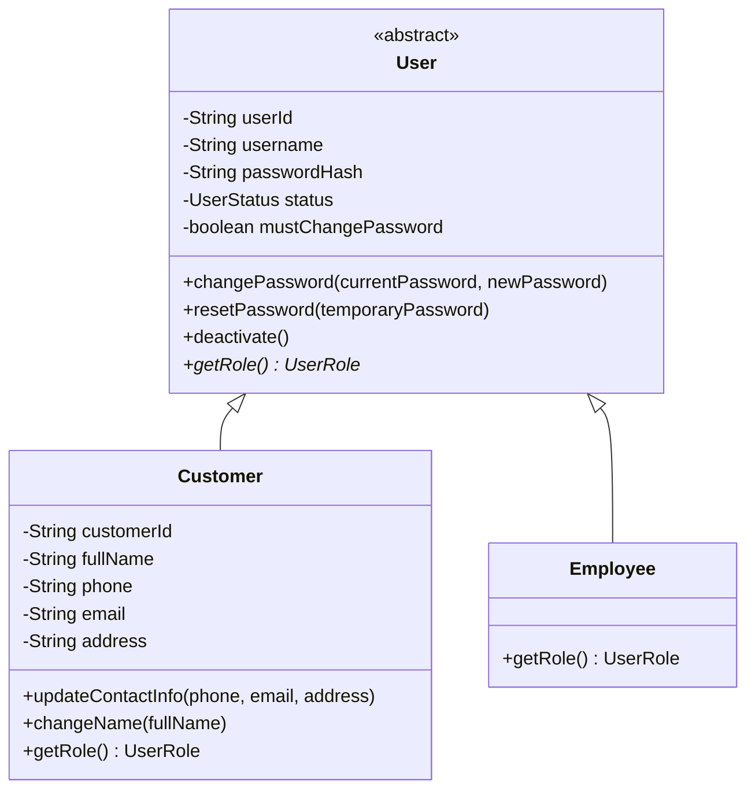

# Bản thử UML: User, Customer, Employee

Trạng thái: bản phác theo hướng User là lớp cha của Customer và Employee; đã chốt dùng một trạng thái chung ở User. Chưa phải UML v1 hoàn chỉnh hoặc mã nguồn.

## Cách đọc

- User là lớp cha trừu tượng, không tạo trực tiếp. Các thuộc tính đăng nhập private được quản lý qua hành vi chung của User.
- Customer kế thừa chức năng đăng nhập và bổ sung dữ liệu hồ sơ đã chốt. Một đối tượng Customer chứa cả phần đăng nhập được kế thừa và phần hồ sơ riêng, không cần thêm CustomerLogin liên kết tới nó.
- Employee kế thừa phần đăng nhập. Phạm vi hiện tại chưa xác định dữ liệu hồ sơ nhân viên riêng nên chưa thêm thuộc tính.
- UserRole có hai giá trị EMPLOYEE và CUSTOMER. getRole() được ghi chồng ở hai lớp con; không lưu thêm trường role có thể mâu thuẫn với loại đối tượng.
- UserStatus có hai giá trị ACTIVE và INACTIVE. Đây là trạng thái hoạt động chung, đồng thời quyết định được phép đăng nhập. Customer không có trạng thái hồ sơ riêng, không có loginEnabled độc lập. mustChangePassword chỉ biểu diễn yêu cầu đổi mật khẩu, không thay thế trạng thái hoạt động.
- Trước khi ngừng hoạt động khách hàng, service phải kiểm tra đã xử lý hết tài khoản và sổ tiết kiệm, rồi cập nhật trạng thái chung của User. Trạng thái đóng/mở tài khoản ngân hàng vẫn được mô hình hóa riêng.
- Service kiểm tra quyền ai được đổi tên, đặt lại mật khẩu hoặc ngừng hoạt động khách hàng. Các phương thức trong UML không tự cấp quyền cho mọi người dùng.
- Getter/setter, constructor, kiểu tham số/trả về đầy đủ và validation chưa được thể hiện ở bản thử.

## Ví dụ Quang

Một Customer của Quang có userId, username, passwordHash và trạng thái hoạt động chung từ lớp cha; có thêm customerId, họ tên và điện thoại/email/địa chỉ ở lớp con. Đối tượng này dùng phương thức đổi mật khẩu và ngừng hoạt động của User.

userId định danh người dùng đăng nhập; customerId là mã hồ sơ khách hàng đã chốt. Cách sinh và liên kết mã sẽ được quyết định khi thiết kế dữ liệu.

## Điểm cần xem trước khi chốt

- Customer đồng thời là người dùng có khả năng đăng nhập; không còn tách hồ sơ thành đối tượng riêng với CustomerLogin.
- Employee hiện chưa có dữ liệu hoặc nghiệp vụ đối tượng riêng ngoài xác định vai trò. Nếu yêu cầu chỉ cần phân biệt vai trò, enum cũng có thể đáp ứng; lợi ích kế thừa ở bản thử chủ yếu là Customer mở rộng dữ liệu/hành vi chung của User.
- Riêng cây User có một cha–hai con. Sơ đồ tổng hợp hiện đã bổ sung LoanAccount, nên cây BankAccount đạt một cha–ba con; không cần thêm vai trò mới vào User để đạt yêu cầu này.
- Chưa chốt username có được thay đổi hay không, và chưa dựng các quan hệ tài khoản, tiết kiệm, giao dịch hoặc Composition.
